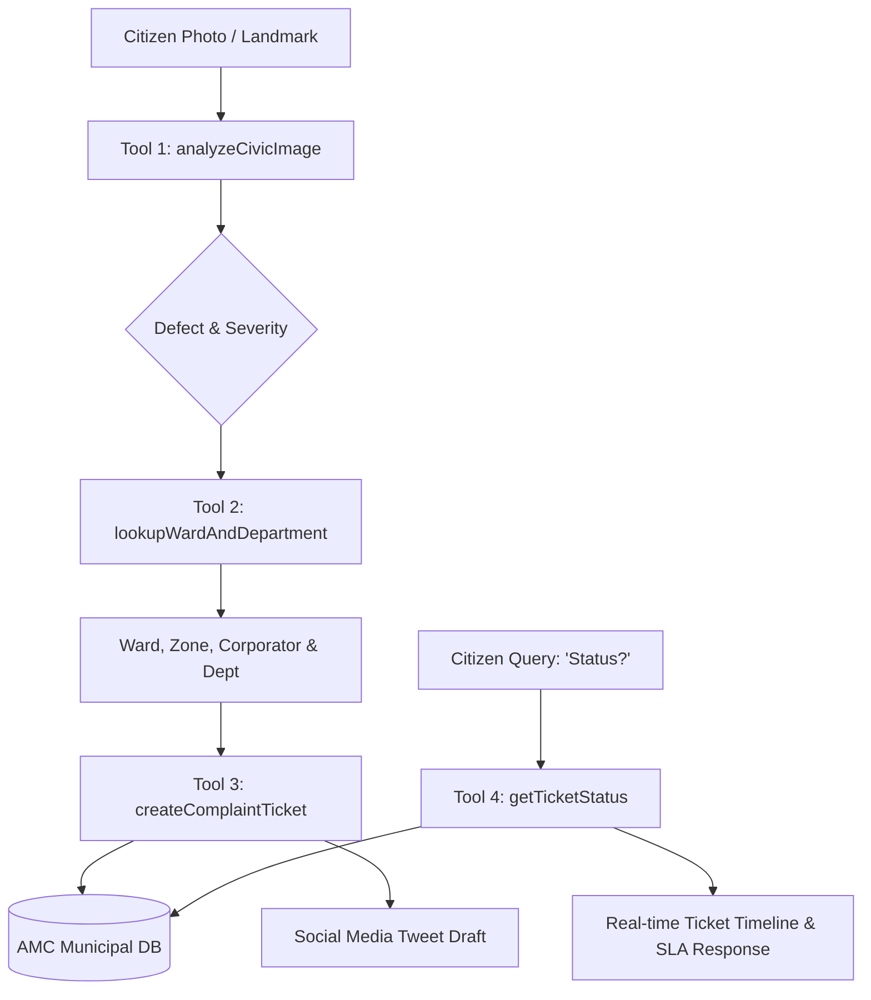

# CivicLens AI — Autonomous Civic Issue & Grievance Agent (AMC)

CivicLens AI solves the civic grievance bottleneck: **A citizen takes a photo $\rightarrow$ the AI Agent autonomously identifies the defect, resolves the Ward and Department, creates a municipal complaint ticket with a tracking ID, and drafts a social escalation post.**

Built for the **Civic Issue AI Agent** Hackathon challenge (01 · Multimodal Vision & Agents).

---

## 🌟 Key Features

1. **Multimodal Defect Classification (Tool 1)**:
   - Detects civic hazards: Potholes, Garbage Dumps, Broken Streetlights, and Water Logging.
   - Extracts severity level (`CRITICAL`, `HIGH`, `MEDIUM`), hazard factors, and detected road artifacts.
   - **Hybrid Architecture**: Uses Google Gemini 1.5 Vision with fallback to a zero-key Computer Vision heuristics engine.

2. **Spatial Ward & Department Resolver (Tool 2)**:
   - Maps user location / landmark / GPS to Ahmedabad Municipal Corporation (AMC) administrative zones and wards (Navrangpura, Bodakdev, Maninagar, Satellite, Sabarmati, etc.).
   - Pinpoints responsible corporator handles (e.g., `@BhavnaDave_AMC`, `@RameshPatel_AMC`) and accountable department (Roads & Bridges, Solid Waste Management, Electrical, Drainage).

3. **Autonomous Municipal Ticketing Engine (Tool 3)**:
   - Mock AMC Central Grievance Database storing live complaints with unique tracking IDs (`AMC-2026-XXXX`).
   - Dynamic SLA calculation (24h to 48h) and dispatch timeline generation.

4. **Conversational Status Inquiry (Tool 4)**:
   - Citizens simply ask *"What's the status?"* or query by Ticket ID.
   - The agent reads live municipal records and replies with current dispatch stage, assigned engineer, and ETA.

5. **Social Media Escalation Post (Requirement Bonus)**:
   - Automatically drafts viral public grievance posts on X (Twitter) tagging `@AmdavadAMC`, the relevant department handle, and the ward corporator.

---

## 🏗️ Agent Tool Architecture



---

## 🚀 Quick Setup & Run Locally

### Prerequisites
- Node.js (v18+)

### Installation
```bash
# Clone the repository
git clone <repo-url>
cd civiclens-agent

# Install dependencies
npm install

# Run the autonomous agent server
npm start
```

Open **http://localhost:3000** in your browser to access the live app.

---

## 📁 Repository Structure
```
civiclens-agent/
├── server.js              # Express API & agent execution pipeline endpoints
├── agent.js               # Multi-tool agent engine (Vision, Ward Resolver, DB Ticket, Status)
├── package.json           # Project manifest & dependencies
├── data/
│   ├── wards.json         # AMC administrative wards, zones & corporator directory
│   ├── departments.json   # AMC departmental matrix, SLAs & escalation paths
│   └── tickets.json       # Central municipal mock grievance ledger
└── public/
    └── index.html         # Modern cyber-civic UI with live agent pipeline execution & chat
```
